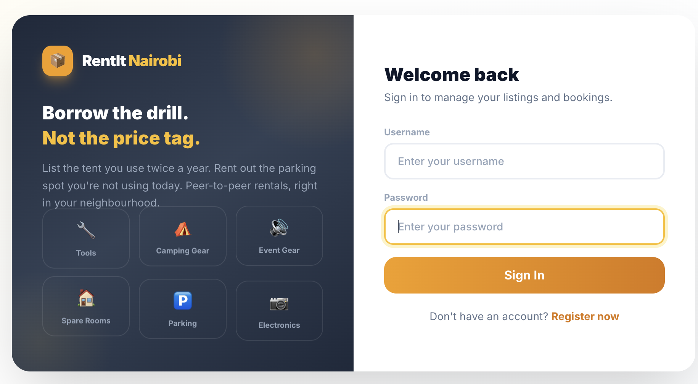
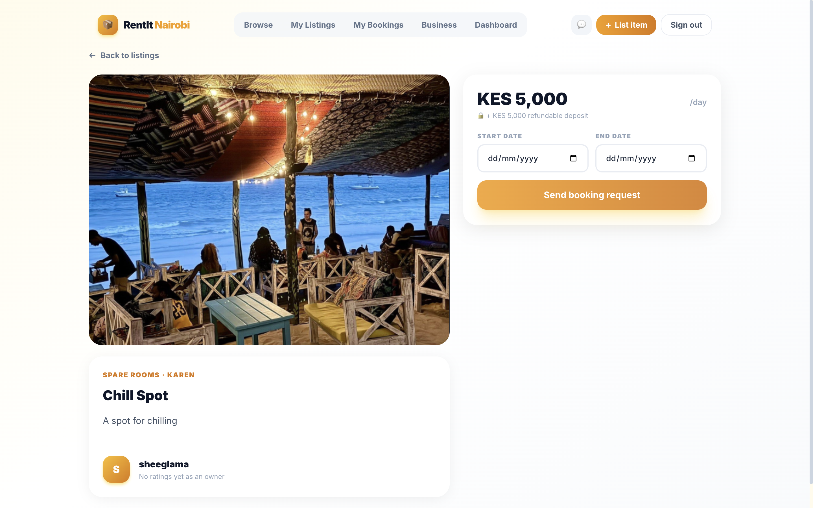

# RentIt Nairobi

A peer-to-peer marketplace for renting tools, equipment, rooms, and parking spots in Nairobi. Renters can request bookings and pay by M-Pesa; owners can manage listings, bookings, and deposits.

## Screenshots

| Landing page | My listings |
|---|---|
|  |  |

## Features

- Browse and search listings by category and area, with availability dates.
- Create and manage listings with Cloudinary-hosted photos.
- Request and manage bookings, message the other party, and leave two-way ratings.
- Pay for accepted bookings through M-Pesa STK Push, including a refundable deposit.
- Release or claim deposits after a completed booking.
- Feature listings, subscribe to business plans, and view admin revenue reports.

## Tech stack

- **Frontend:** React 18, React Router 6, Tailwind CSS; JavaScript with TypeScript configured for gradual adoption.
- **Backend:** FastAPI, SQLAlchemy, Pydantic.
- **Database:** SQLite by default; PostgreSQL can be configured with `DATABASE_URL`.
- **Integrations:** Safaricom Daraja (M-Pesa) and Cloudinary.

## Run locally

### Requirements

- Node.js 22 or newer
- Python 3.10 or newer
- npm and pip

### 1. Set up the backend

From the repository root:

```bash
cd backend
python3 -m venv venv
source venv/bin/activate
pip install -r requirements.txt
cp .env.example .env
```

Edit `backend/.env` before running the app. Set a private `JWT_SECRET`. Replace or remove placeholder values. Add Cloudinary credentials to enable photo uploads and M-Pesa sandbox credentials to test payments. Only set `ADMIN_PASSWORD` if you want to create a local admin account.

Seed sample areas, categories, and listings if desired:

```bash
python seed_data.py
```

The seed script creates a local demo account (`demo_owner` / `demo1234`). Use it only for local development.

Start the API while your virtual environment is active:

```bash
uvicorn main:app --reload --port 8001
```

The API is at `http://localhost:8001`; interactive API documentation is at `http://localhost:8001/docs`.

### 2. Set up the frontend

In a second terminal, from the repository root:

```bash
npm install
npm start
```

Create React App opens the frontend at `http://localhost:3000` by default. If that port is busy, it may offer another one. The frontend uses `http://localhost:8001` for the API by default; set `REACT_APP_API_BASE_URL` to override it.

## Useful commands

```bash
npm run build        # Create a production build
npm run format:check # Check formatting of TypeScript files
```

## Project layout

```text
src/                 React application and components
backend/             FastAPI application, models, schemas, and integrations
public/Screenshots/  Application screenshots
```

For development, messaging uses periodic API polling. Cloudinary uploads and M-Pesa payments require the corresponding provider credentials in `backend/.env`.
